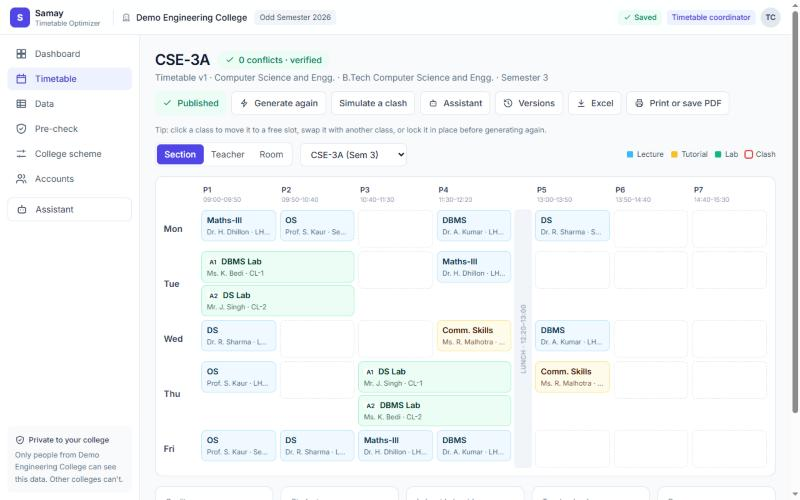
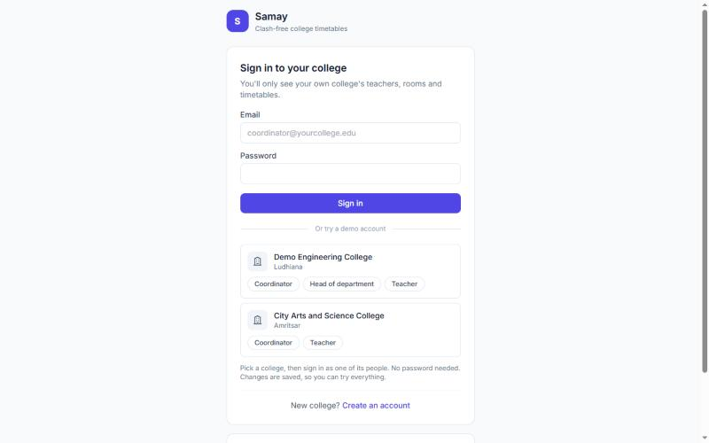
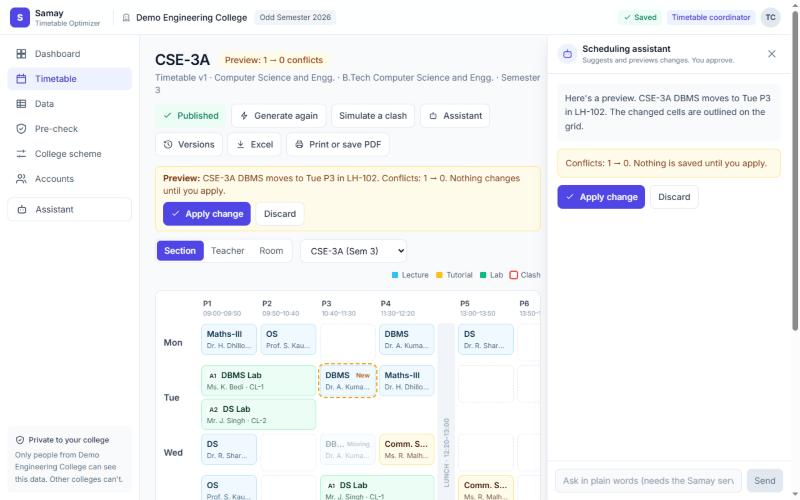
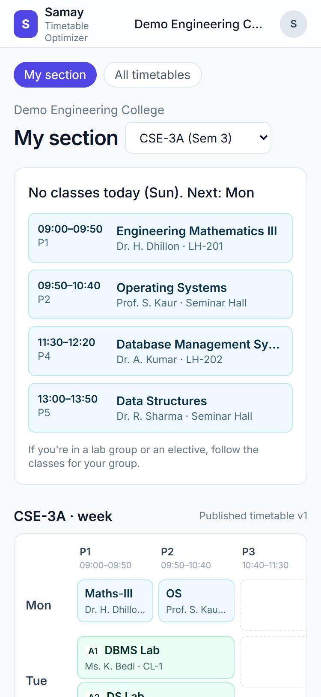

# Samay: College Timetable Optimizer

**Samay** (समय, "time") builds a **clash-free weekly timetable for any college**: sections and lab groups, teachers
who teach across departments, shared rooms and labs, electives and reserved times. Every timetable is re-checked by an
independent clash checker before it is saved, so "0 conflicts" is proved, not promised.

Built for **Hackathon 1, Punjab Jobs AI Bootcamp (J-PAL South Asia)**, individual project, with Claude Code.

**Live demo: https://samay-timetable.onrender.com** · one-click demo accounts on the sign-in page, no password needed.
(Free hosting sleeps when unused: the first visit can take about a minute to wake up.)



## Contents
- [Screenshots](#screenshots)
- [The problem](#the-problem)
- [Who uses it](#who-uses-it)
- [Features](#features)
- [Try it](#try-it)
- [How to use it](#how-to-use-it)
- [5-minute demo](#5-minute-demo)
- [How it works](#how-it-works)
- [Settings](#settings)
- [Deploying](#deploying)
- [Tests](#tests)
- [Project structure](#project-structure)

## Screenshots
| Sign-in with one-click demo accounts | Fixing a clash: preview before anything is saved | A student's phone |
|---|---|---|
|  |  |  |

## The problem
Most colleges still build timetables by hand each semester. Departments fit their sections, labs and teachers into the
week and compete for shared seminar halls and computer labs. It takes weeks and still leaves clashes, uneven loads and
empty rooms. Samay lets a college enter its data once (or import it from Excel), generate a timetable in seconds, fix it
by hand or with an assistant, and share it with teachers and students.

## Who uses it
| Role | What they do in Samay |
|---|---|
| **Timetable coordinator** | Sets up the college's week and data, generates, edits and publishes timetables, manages accounts and student access |
| **Head of department (HOD)** | Keeps their own department's courses, sections, teachers, subjects and classes up to date and marks it ready |
| **Teacher** | Sees their own week and today's classes, browses any published timetable, marks periods they can't teach |
| **Student** | No account: enters the college's code once (or scans its QR poster) and sees today's classes and any timetable |

Each college sees only its own data and never learns which other colleges use Samay.

## Features
**Timetables that work (no clashes)**
- Generator built on Google OR-Tools (CP-SAT), with a time limit and progress shown while it runs.
- Hard rules, never broken:
  - no teacher, room, section or lab group in two places at once;
  - room big enough and of the right type;
  - every class gets its weekly periods;
  - labs in back-to-back periods that don't cross lunch;
  - teachers' unavailable times and daily limits respected;
  - electives keep their sections free;
  - reserved times stay free.
- An independent clash checker re-checks every timetable (generated or hand-edited). Nothing with a clash is ever saved.
- Pre-check before generating, in plain English. It catches teachers with too many periods, sections that don't fit in the week, too few rooms, and rooms too small.

**Any college, any scheme**
- Each college sets its own days, periods, breaks, lunch, lab length, lectures per subject a week, lab group naming and
  elective class size. Nothing is hard-coded.
- Structure: Department → Course → Section (semester) → lab groups (A1, A2 …), which can run **different labs at the same time**.
  Tutorials can be taken by the whole section or in lab groups.
- Cross-department teaching: any teacher can teach any department's section, and subjects can be shared.
- **Electives:** students of several sections (even from several departments) choose a subject. Type how many chose each one; big electives split into batches (CV-1, CV-2) of the college's class size. Options run at the same time in different rooms where possible.
- **Reserved times:** keep periods free for some sections, e.g. an open elective another department teaches.
- New colleges sign up and start with a sensible week.

**Easy to use**
- A "Getting started" checklist, forms with plain-English error messages, and Excel/CSV import with downloadable
  templates: one file per list, or one workbook with a sheet per list (each Data tab picks its sheet by name).
- Timetable by **section, teacher or room**: colour-coded, lab blocks merged, lab groups side by side, reserved times greyed out.
- **Print / save as PDF** (A4) and **Excel export**: one sheet per section and per teacher, plus every class in one list.
- Works on phones.

**Editing, sharing and the AI assistant**
- Click a class to **move** it to a free slot (shown in green) or **swap** it. **Lock** classes so they stay put when you generate again.
- **Versions:** every timetable is kept. View, restore or delete old versions. Versions made from older data are marked.
- **Publish** the version teachers and students see. Generating again doesn't change it until you publish again.
- **AI scheduling assistant** (Claude), optional:
  - Ask in plain words, e.g. "Dr. Kumar is absent on Monday, which classes need to move?"
  - It looks at your timetable, finds free slots and proposes changes.
  - Every proposal is checked for clashes and shown as a **preview**. Nothing is saved until you click **Apply**.
- **Student access:** one code per college, a share link and a printable **QR poster**. Change the code or turn it off at any time.

**Privacy and safety**
- Every request is tied to the signed-in user's college. The college never comes from the address or the request. Tests prove college A can't read college B.
- Passwords are hashed with scrypt, sessions use httpOnly cookies, sign-in attempts are rate-limited, and wrong student codes are blocked after repeated tries.
- People choose their own passwords through one-time invite links (7 days). Forgot password sends a one-time reset link
  (1 hour) without revealing whether an email has an account, and signs the person out everywhere else.

## Try it
### Online
Open the live demo link above. On the sign-in page, pick a college, then **Coordinator**, **Head of department** or
**Teacher**. **Demo Engineering College** is a full example: its timetable is already generated and published, so every
role shows it straight away. **Guru Nanak Dev Engineering College (demo)** is almost empty, so you can try entering a real
college's data. **Students:** tap **I'm a student** and enter the code **DEMO-2026** (Demo Engineering College). 

The free hosting plan restarts the demo database now and then, so changes you make online may not last.

### On your computer (Windows)
You need **Python 3.12** and **Git**.
```bash
git clone <this repository's URL>
```
```bash
cd timetable-project\backend
```
```bash
python -m venv .venv
```
```bash
.\.venv\Scripts\python -m pip install -r requirements.txt
```
```bash
.\.venv\Scripts\python -m uvicorn app.main:app --port 8000
```
Open **http://localhost:8000**. The first start creates a local database with two demo colleges and their demo
accounts (one-click on the sign-in page). On macOS/Linux use `.venv/bin/python` instead of `.\.venv\Scripts\python`.

- **Start over with clean demo data:** stop the server, then run `.\.venv\Scripts\python -m app.seed --reset`.
- **Turn on the AI assistant (optional):** set your Anthropic API key in the terminal before starting the server, e.g.
  `$env:ANTHROPIC_API_KEY = "sk-ant-..."` in PowerShell (or `setx ANTHROPIC_API_KEY "sk-ant-..."` once). Never put the key in
  a file in this project. Each question uses your API credit.
- **Offline demo:** opening `web/index.html` directly works with built-in demo colleges and a simple in-browser
  generator. Nothing is saved.

## How to use it
**Timetable coordinator**
1. **College scheme:** check working days, period times, breaks, lectures per subject a week, lab length and elective class size.
2. **Data:** add (or import from Excel) departments, courses, sections with lab groups, teachers (with times they can't
   teach), rooms and labs, subjects, and **teaching assignments** (who teaches which subject to which section or lab group).
   Add **Electives** and **Reserved times** if you have them.
3. **Pre-check:** fix anything marked red.
4. **Generate:** a clash-free week in seconds. Look at it by section, teacher or room.
5. **Adjust:** click a class to move or swap it, lock what must not move, or ask the **Assistant**. Generate again; locked classes stay.
6. **Publish:** teachers and students now see this version.
7. **Share:** invite HODs and teachers under **Accounts**. Each gets a one-time link (emailed if email is set up, or
   copy it and send it yourself) to choose their own password. Give teachers an email (in Data → Teachers, or an
   **Email** column in the Teachers sheet) and **Invite all teachers** invites everyone without an account in one click,
   with a "Copy all links" list for WhatsApp. After that, everyone just signs in with their email and password. Turn on **Student access** to get the code, link and QR poster.
   Forgot a password? Use **Forgot password?** on the sign-in page, or the coordinator's **Reset link** next to their name.
8. Print, save as PDF or export to Excel from the Timetable page.

**Head of department:** keep your department's data complete under **Department data** (other departments' records are
view-only), then click **Mark as ready**. The coordinator sees each department's status on the dashboard.

**Teacher:** **My timetable** shows today's (or the next) classes and your week. **When I can't teach**: click periods,
save. The next generated timetable keeps them free.

**Student:** open the link or scan the QR code (or tap **I'm a student** and type the code). Pick your section to see
today's classes, or open **All timetables** for any section, teacher or room.

## 5-minute demo
1. **Sign-in page:** one-click demo accounts. Pick **Demo Engineering College → Coordinator**.
2. **Dashboard:** setup checklist, scheme summary, department status. Click **Generate timetable** (a few seconds).
3. **Timetable:**
   - Switch Section / Teacher / Room. Notice A1/A2 doing different labs at the same time, and the green "0 conflicts · verified" badge.
   - Click a class: green "Move here" slots; move it, then lock another.
   - **Simulate a clash** → the assistant shows the clash and three fixes → **Preview** → **Apply**.
4. **Data → Electives:** add "Departmental Elective-I" with 100 students for one subject. Watch it become 2 batches; generate again.
5. **Publish**, then **Accounts → Student access → Turn on**. Open the link in a private window: the phone view of a student.
6. Sign in as **Head of department**: only their department is editable. Sign in as **Teacher**: own week, and mark a period as unavailable.

## How it works
```
Browser (web/index.html)        ──JSON over HTTPS──►  FastAPI (backend/app)
  one page, live mode when served by Samay            ├─ sign-in, roles, college from the session only
  falls back to offline demo mode                     ├─ SQLite: one checked JSON document per college, timetable versions
                                                      ├─ background generation job (one per college)
                                                      └─ solver/ (pure Python)
                                                            college.py   data → lookup tables, elective batches
                                                            model.py     CP-SAT generator (hard rules + preferences)
                                                            validator.py independent clash checker
                                                            metrics.py   scorecard (gaps, labs side by side, loads)
```
- **Generator:** one yes/no choice per (class, day, start period, room), already filtered by room type and size, teacher
  availability and breaks. Constraints keep teachers, rooms and sections single-booked and give each class its periods.
  The objective spreads subjects over the week, avoids late periods and idle gaps, keeps lab groups in step, and runs an
  elective's options together.
- **Clash checker:** a separate implementation of every hard rule. A timetable is saved only if it finds 0 problems.
  The page uses the same rules live, so it never offers a move the server would refuse.
- **Data format:** `backend/app/schema.py` (Pydantic) checks every field and cross-reference, with plain-English messages.
- **AI assistant:** Claude (`claude-opus-5-5`) with read-only tools bound to the signed-in college: clashes, a section,
  teacher or room timetable, free slots, free rooms, teacher load, and `propose_change`. That tool only checks moves; the
  coordinator applies them.

Project notes for Claude Code (structure, rules, glossary, conventions) are in [CLAUDE.md](CLAUDE.md). The product plan
and roadmap are in [docs/requirements.md](docs/requirements.md).

## Settings
Set as environment variables before starting the server.

| Variable | Default | What it does |
|---|---|---|
| `SAMAY_DEMO_LOGIN` | `1` | One-click demo accounts on the sign-in page. **Set `0` for a real college.** |
| `SAMAY_SIGNUP` | `1` | Lets new colleges create an account |
| `SAMAY_COOKIE_SECURE` | `0` | Set `1` when served over HTTPS |
| `SAMAY_SOLVE_SECONDS` | `120` | Time limit for one generation run (a college of about 25 sections and 50 teachers needs about a minute) |
| `SAMAY_SOLVER_WORKERS` | `8` | CPU threads per run (use 1–2 on small servers) |
| `ANTHROPIC_API_KEY` | – | Turns on the AI assistant (`SAMAY_ASSISTANT=0` turns it off again) |
| `SAMAY_ASSISTANT_DAILY_LIMIT` | `60` | Most AI assistant questions a day for the whole site (`0` = no limit) |
| `SAMAY_DB` | `backend/data/samay.db` | Where the database file lives |
| `SAMAY_DEMO_READY` | `1` on Render, else `0` | At start, generate and publish the demo college's timetable and turn on its student code (DEMO-2026) |
| `SAMAY_SMTP_HOST`, `SAMAY_SMTP_PORT`, `SAMAY_SMTP_USER`, `SAMAY_SMTP_PASSWORD`, `SAMAY_EMAIL_FROM` | – | Email for invites and password resets, through any SMTP server (e.g. Gmail with an app password, or Brevo). Without it, Samay shows the links for the coordinator to share |
| `SAMAY_PUBLIC_URL` | – | The site's address, used in emailed links |

## Deploying
[`render.yaml`](render.yaml) deploys Samay as one free web service on [Render](https://render.com). In Render, choose
**New → Blueprint**, connect this repository and confirm. The API and the app page are served from the same address.
The free plan has no permanent disk, so the database starts again from the demo colleges after a restart. That's fine
for a demo; a real college needs a paid plan with a disk (set `SAMAY_DB` to a path on it) and `SAMAY_DEMO_LOGIN=0`.

## Tests
```bash
cd backend
.\.venv\Scripts\python -m pytest
```
236 tests cover:
- the clash checker (a passing and a failing case for every rule);
- the generator on both demo colleges, electives, reserved times and locks;
- the pre-check and the data checks;
- every API area;
- roles (coordinator, HOD, teacher, student);
- college privacy: one college can never read or change another's data.

The AI assistant is tested with a stand-in for Claude, so the tests need no API key.

## Project structure
```
backend/
  app/          FastAPI app: main.py, schema.py (data format), db.py, auth.py, jobs.py,
                routers/ (auth, college, timetables, users, teacher, students, assistant),
                services/ (pre-check, publishing, departments, assistant tools, …)
  solver/       college.py, model.py (CP-SAT), validator.py (clash checker), metrics.py
  data/         colleges/*.json (demo colleges), demo_users.json (demo accounts)
  tests/        pytest suite
web/            the app's front end (index.html) and its prebuilt Tailwind CSS
docs/           requirements.md (product plan), screenshots/
render.yaml     deployment
CLAUDE.md       project notes for Claude Code
```
